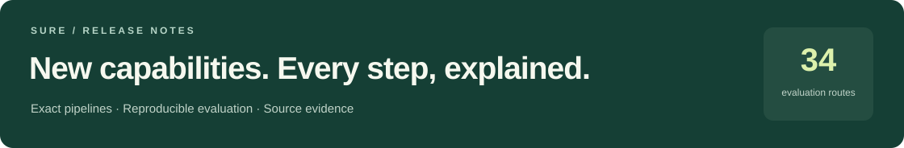

# Release notes

<!-- generated by news-agent; do not edit inside this block -->



New evaluation capabilities, their exact pipelines, and the source behind each update.

[Visual release notes](index.html) · [Latest updates](latest.md)

<a id="ear-1-scoring"></a>

### EAR-1 challenge scoring

<kbd>Supported</kbd> &nbsp; 18 Nov 2026

Score diarization with DER and Mandarin speaker-attributed ASR with cpCER.

| Task | Metric | Evaluation path |
| :--- | :--- | :--- |
| **SD** | **DER** | Submission conversion → EAR-1 scorer → `report.json` |
| **SA-ASR / zh** | **cpCER** | Submission conversion → EAR-1 normalization → EAR-1 scorer → `report.json` |

<details>
<summary>Exact pipeline IDs &amp; versioned nodes</summary>

**SD / DER**

```text
sd.any.der.conversion_sd_ear1_submission_v1.ear1_scorer_v1
```

`conversion/sd__ear1_submission` (v1) → `scoring/ear1_scorer` (v1) → `report.json`

**SA-ASR / cpCER**

```text
sa_asr.zh.cpcer.conversion_sa_asr_ear1_submission_v1.ear1_norm_v1.ear1_scorer_v1
```

`conversion/sa_asr__ear1_submission` (v1) → `normalization/ear1_norm` (v1) → `scoring/ear1_scorer` (v1) → `report.json`

</details>

> **Before you run**
>
> Use the organizer scorer with SciPy and supply sessions.json with a D1 or R1 track.

[Full announcement](../../docs/news/index.md#ear-1-scoring) · Task docs: [sa_asr](https://github.com/PigeonDan1/sure-evaluation/blob/c1bc96cf865baef07e37f702a8286d3a6c68a5a2/docs/tasks/sa_asr.md) · [sd](https://github.com/PigeonDan1/sure-evaluation/blob/c1bc96cf865baef07e37f702a8286d3a6c68a5a2/docs/tasks/sd.md) · [Catalog](https://github.com/PigeonDan1/sure-evaluation/blob/c1bc96cf865baef07e37f702a8286d3a6c68a5a2/docs/pipeline_catalog.jsonl) · [Source change](https://github.com/PigeonDan1/sure-evaluation/commit/c1bc96cf865baef07e37f702a8286d3a6c68a5a2)

<details>
<summary>Source &amp; validation</summary>

Not run by news-agent; see source tests and commit checks.

</details>


Revision 2 of [ear-1](index.md#ear-1).

---

<a id="fd-bench"></a>

### FD-Bench dialogue timing

<kbd>Supported</kbd> &nbsp; 12 Nov 2026

Measure when a system starts speaking, replies early or interrupts a user.

| Task | Metric | Evaluation path |
| :--- | :--- | :--- |
| **FULL-DUPLEX** | **ird** | duplex timeline → fdbench timing → `report.json` |
| **FULL-DUPLEX** | **fsed** | duplex timeline → fdbench timing → `report.json` |
| **FULL-DUPLEX** | **ert** | duplex timeline → fdbench timing → `report.json` |
| **FULL-DUPLEX** | **eit** | duplex timeline → fdbench timing → `report.json` |

<details>
<summary>Exact pipeline IDs &amp; versioned nodes</summary>

**FULL-DUPLEX / ird**

```text
full_duplex.any.ird.duplex_timeline_v1.fdbench_timing_v1
```

`normalization/duplex_timeline` (v1) → `scoring/fdbench_timing` (v1) → `report.json`

**FULL-DUPLEX / fsed**

```text
full_duplex.any.fsed.duplex_timeline_v1.fdbench_timing_v1
```

`normalization/duplex_timeline` (v1) → `scoring/fdbench_timing` (v1) → `report.json`

**FULL-DUPLEX / ert**

```text
full_duplex.any.ert.duplex_timeline_v1.fdbench_timing_v1
```

`normalization/duplex_timeline` (v1) → `scoring/fdbench_timing` (v1) → `report.json`

**FULL-DUPLEX / eit**

```text
full_duplex.any.eit.duplex_timeline_v1.fdbench_timing_v1
```

`normalization/duplex_timeline` (v1) → `scoring/fdbench_timing` (v1) → `report.json`

</details>

> **Before you run**
>
> Supply saved user and system speech intervals with the same time origin.

[Full announcement](../../docs/news/index.md#fd-bench) · Task docs: [full_duplex](https://github.com/PigeonDan1/sure-evaluation/blob/549eb711483e7c4e515479864bca8e0abd558572/docs/tasks/full_duplex.md) · [Catalog](https://github.com/PigeonDan1/sure-evaluation/blob/549eb711483e7c4e515479864bca8e0abd558572/docs/pipeline_catalog.jsonl) · [Source change](https://github.com/PigeonDan1/sure-evaluation/commit/549eb711483e7c4e515479864bca8e0abd558572)

<details>
<summary>Source &amp; validation</summary>

Not run by news-agent; see source tests and commit checks.

</details>


---

<a id="slu-judge"></a>

### SLU answer judging

<kbd>Supported</kbd> &nbsp; 11 Nov 2026

Grade spoken-language understanding answers against a custom rubric on a 0–100 scale.

| Task | Metric | Evaluation path |
| :--- | :--- | :--- |
| **SLU** | **llm\_judge** | llm judge → `report.json` |

<details>
<summary>Exact pipeline IDs &amp; versioned nodes</summary>

**SLU / llm\_judge**

```text
slu.any.llm_judge.llm_judge_v1
```

`scoring/llm_judge` (v1) → `report.json`

</details>

> **Before you run**
>
> Provide text answers, prompts, a rubric and a configured judge. Scores depend on the rubric.

[Full announcement](../../docs/news/index.md#slu-judge) · Task docs: [slu](https://github.com/PigeonDan1/sure-evaluation/blob/137fbcc8b89b8c96ca10e641d409808c22165435/docs/tasks/slu.md) · [Catalog](https://github.com/PigeonDan1/sure-evaluation/blob/137fbcc8b89b8c96ca10e641d409808c22165435/docs/pipeline_catalog.jsonl) · [Source change](https://github.com/PigeonDan1/sure-evaluation/commit/137fbcc8b89b8c96ca10e641d409808c22165435)

<details>
<summary>Source &amp; validation</summary>

Not run by news-agent; see source tests and commit checks.

</details>


---

<a id="etc-bench"></a>

### ETC-Bench transcript scoring

<kbd>Supported</kbd> &nbsp; 09 Nov 2026

Normalize equivalent written forms on both sides of an ASR comparison in 12 languages.

| Task | Metric | Evaluation path |
| :--- | :--- | :--- |
| **ASR / ar** | **cer** | etc canonicalization → wenet cer → `report.json` |
| **ASR / bn** | **wer** | etc canonicalization → wenet wer → `report.json` |
| **ASR / de** | **wer** | etc canonicalization → wenet wer → `report.json` |
| **ASR / en** | **wer** | etc canonicalization → wenet wer → `report.json` |
| **ASR / fa** | **wer** | etc canonicalization → wenet wer → `report.json` |
| **ASR / fr** | **wer** | etc canonicalization → wenet wer → `report.json` |
| **ASR / hi** | **wer** | etc canonicalization → wenet wer → `report.json` |
| **ASR / id** | **wer** | etc canonicalization → wenet wer → `report.json` |
| **ASR / ja** | **cer** | etc canonicalization → wenet cer → `report.json` |
| **ASR / ru** | **wer** | etc canonicalization → wenet wer → `report.json` |
| **ASR / vi** | **wer** | etc canonicalization → wenet wer → `report.json` |
| **ASR / zh** | **cer** | etc canonicalization → wenet cer → `report.json` |

<details>
<summary>Exact pipeline IDs &amp; versioned nodes</summary>

**ASR / cer**

```text
asr.ar.cer.etc_canonicalization_ar_v1.wenet_cer_v1
```

`normalization/etc_canonicalization` (v1) → `scoring/wenet_cer` (v1) → `report.json`

**ASR / wer**

```text
asr.bn.wer.etc_canonicalization_bn_v1.wenet_wer_v1
```

`normalization/etc_canonicalization` (v1) → `scoring/wenet_wer` (v1) → `report.json`

**ASR / wer**

```text
asr.de.wer.etc_canonicalization_de_v1.wenet_wer_v1
```

`normalization/etc_canonicalization` (v1) → `scoring/wenet_wer` (v1) → `report.json`

**ASR / wer**

```text
asr.en.wer.etc_canonicalization_en_v1.wenet_wer_v1
```

`normalization/etc_canonicalization` (v1) → `scoring/wenet_wer` (v1) → `report.json`

**ASR / wer**

```text
asr.fa.wer.etc_canonicalization_fa_v1.wenet_wer_v1
```

`normalization/etc_canonicalization` (v1) → `scoring/wenet_wer` (v1) → `report.json`

**ASR / wer**

```text
asr.fr.wer.etc_canonicalization_fr_v1.wenet_wer_v1
```

`normalization/etc_canonicalization` (v1) → `scoring/wenet_wer` (v1) → `report.json`

**ASR / wer**

```text
asr.hi.wer.etc_canonicalization_hi_v1.wenet_wer_v1
```

`normalization/etc_canonicalization` (v1) → `scoring/wenet_wer` (v1) → `report.json`

**ASR / wer**

```text
asr.id.wer.etc_canonicalization_id_v1.wenet_wer_v1
```

`normalization/etc_canonicalization` (v1) → `scoring/wenet_wer` (v1) → `report.json`

**ASR / cer**

```text
asr.ja.cer.etc_canonicalization_ja_v1.wenet_cer_v1
```

`normalization/etc_canonicalization` (v1) → `scoring/wenet_cer` (v1) → `report.json`

**ASR / wer**

```text
asr.ru.wer.etc_canonicalization_ru_v1.wenet_wer_v1
```

`normalization/etc_canonicalization` (v1) → `scoring/wenet_wer` (v1) → `report.json`

**ASR / wer**

```text
asr.vi.wer.etc_canonicalization_vi_v1.wenet_wer_v1
```

`normalization/etc_canonicalization` (v1) → `scoring/wenet_wer` (v1) → `report.json`

**ASR / cer**

```text
asr.zh.cer.etc_canonicalization_zh_v1.wenet_cer_v1
```

`normalization/etc_canonicalization` (v1) → `scoring/wenet_cer` (v1) → `report.json`

</details>

> **Before you run**
>
> Supply the ETC checkpoint. Arabic, Japanese and Chinese use CER. The other nine language routes use WER.

[Full announcement](../../docs/news/index.md#etc-bench) · Task docs: [asr](https://github.com/PigeonDan1/sure-evaluation/blob/abfdd68801cce39e28a27ccfb9335deee091a27f/docs/tasks/asr.md) · [Catalog](https://github.com/PigeonDan1/sure-evaluation/blob/abfdd68801cce39e28a27ccfb9335deee091a27f/docs/pipeline_catalog.jsonl) · [Source change](https://github.com/PigeonDan1/sure-evaluation/commit/abfdd68801cce39e28a27ccfb9335deee091a27f)

<details>
<summary>Source &amp; validation</summary>

Not run by news-agent; see source tests and commit checks.

</details>


---

<a id="openbench-se"></a>

### OpenBench speech enhancement

<kbd>Supported</kbd> &nbsp; 02 Nov 2026

Score intelligibility, spectral distortion and predicted speech quality with opt-in metrics.

| Task | Metric | Evaluation path |
| :--- | :--- | :--- |
| **SE** | **estoi** | estoi → `report.json` |
| **SE** | **lsd** | lsd → `report.json` |
| **SE** | **lps** | lps → `report.json` |
| **SE** | **dnsmos\_p808** | dnsmos p808 → `report.json` |
| **SE** | **dnsmos\_sig** | dnsmos sig → `report.json` |
| **SE** | **dnsmos\_bak** | dnsmos bak → `report.json` |
| **SE** | **nsrmr** | nsrmr → `report.json` |
| **SE** | **squim\_stoi** | squim stoi → `report.json` |
| **SE** | **squim\_pesq** | squim pesq → `report.json` |
| **SE** | **squim\_si\_sdr** | squim si sdr → `report.json` |
| **SE** | **nisqa\_mos** | nisqa mos → `report.json` |
| **SE** | **nisqa\_noi** | nisqa noi → `report.json` |
| **SE** | **nisqa\_dis** | nisqa dis → `report.json` |
| **SE** | **nisqa\_col** | nisqa col → `report.json` |
| **SE** | **nisqa\_loud** | nisqa loud → `report.json` |

<details>
<summary>Exact pipeline IDs &amp; versioned nodes</summary>

**SE / estoi**

```text
se.any.estoi.estoi_v1
```

`scoring/estoi` (v1) → `report.json`

**SE / lsd**

```text
se.any.lsd.lsd_v1
```

`scoring/lsd` (v1) → `report.json`

**SE / lps**

```text
se.any.lps.lps_v1
```

`scoring/lps` (v1) → `report.json`

**SE / dnsmos\_p808**

```text
se.any.dnsmos_p808.dnsmos_p808_v1
```

`scoring/dnsmos_p808` (v1) → `report.json`

**SE / dnsmos\_sig**

```text
se.any.dnsmos_sig.dnsmos_sig_v1
```

`scoring/dnsmos_sig` (v1) → `report.json`

**SE / dnsmos\_bak**

```text
se.any.dnsmos_bak.dnsmos_bak_v1
```

`scoring/dnsmos_bak` (v1) → `report.json`

**SE / nsrmr**

```text
se.any.nsrmr.nsrmr_v1
```

`scoring/nsrmr` (v1) → `report.json`

**SE / squim\_stoi**

```text
se.any.squim_stoi.squim_stoi_v1
```

`scoring/squim_stoi` (v1) → `report.json`

**SE / squim\_pesq**

```text
se.any.squim_pesq.squim_pesq_v1
```

`scoring/squim_pesq` (v1) → `report.json`

**SE / squim\_si\_sdr**

```text
se.any.squim_si_sdr.squim_si_sdr_v1
```

`scoring/squim_si_sdr` (v1) → `report.json`

**SE / nisqa\_mos**

```text
se.any.nisqa_mos.nisqa_mos_v1
```

`scoring/nisqa_mos` (v1) → `report.json`

**SE / nisqa\_noi**

```text
se.any.nisqa_noi.nisqa_noi_v1
```

`scoring/nisqa_noi` (v1) → `report.json`

**SE / nisqa\_dis**

```text
se.any.nisqa_dis.nisqa_dis_v1
```

`scoring/nisqa_dis` (v1) → `report.json`

**SE / nisqa\_col**

```text
se.any.nisqa_col.nisqa_col_v1
```

`scoring/nisqa_col` (v1) → `report.json`

**SE / nisqa\_loud**

```text
se.any.nisqa_loud.nisqa_loud_v1
```

`scoring/nisqa_loud` (v1) → `report.json`

</details>

> **Before you run**
>
> Reference-based metrics require aligned clean audio. Learned quality estimates depend on the selected model.

[Full announcement](../../docs/news/index.md#openbench-se) · Task docs: [se](https://github.com/PigeonDan1/sure-evaluation/blob/204ffe814fa7b0797e8471d80916339d1dfd0690/docs/tasks/se.md) · [Catalog](https://github.com/PigeonDan1/sure-evaluation/blob/204ffe814fa7b0797e8471d80916339d1dfd0690/docs/pipeline_catalog.jsonl) · [Source change](https://github.com/PigeonDan1/sure-evaluation/commit/204ffe814fa7b0797e8471d80916339d1dfd0690)

<details>
<summary>Source &amp; validation</summary>

Not run by news-agent; see source tests and commit checks.

</details>
