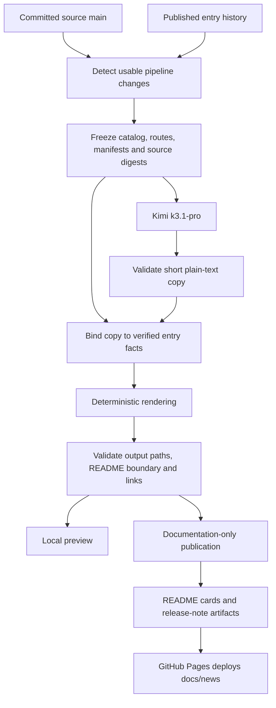

# Announcement architecture

The announcement package converts verified evaluation changes into release
content. Evaluation source is read as immutable Git evidence. Kimi chooses or
writes prose; deterministic code owns pipeline identity, source links, dates,
validation and the set of files that can be published.

## Data flow



`run` and `poll` share evidence validation, rendering and output
validation. Their discovery and publication policies are different; the
configured deployment is not an alias for general dry-run polling.

## Module responsibilities

| Module | Responsibility |
| --- | --- |
| `git.py` | Read immutable Git snapshots and reject unsafe evidence paths |
| `detector.py` | Detect newly registered atomic pipelines and attribute them to first-parent source changes |
| `evidence.py` | Cross-check catalog rows against routes, node order/versions, manifests and task documentation; freeze file digests |
| `contract.py` | Strict entry/copy schema, source binding, immutable history and revision relationships |
| `kimi_client.py` | Fixed `k3.1-pro` client, dedicated credential, bounded retries and complete-response validation |
| `state.py` | Process lock and SQLite storage for cursors; job queue and copy cache used by `run` |
| `cli.py` | Local render/check/diagnostics and the generic queued `run` workflow |
| `polling.py` | New-capability/revision review and direct publication to the configured target repository |
| `renderer.py` | Common newest-first selection and generation of README, Markdown release notes and page assets |
| `readme_cards.py` | White 760 × 280 SVG cards and GitHub's horizontal README strip |
| `web.py`, `templates/news.html` | Localized release timeline, source links, filtering, theme and pipeline details |
| `publisher.py` | Exact publication allowlist, README boundaries, link/anchor validation, isolated writes and generic branch/PR publication |
| `deploy/` | Optional local preview builder and generic systemd installation templates |

## Evidence and model boundary

A candidate includes source SHA, catalog rows, task routes, ordered versioned
nodes, required roles, task documentation, file digests and a bounded diff.
Source text is evidence, not instructions to the model. The model returns only
plain prose; it cannot supply arbitrary markup, file paths or publication
links. Entry validation rereads the declared source commit before publication.

The generic `run` path requests English copy for newly registered pipelines.
The configured polling path first asks Kimi to select material new capabilities or
revisions, then requests an English and Chinese draft for each selection.
Neither path treats an open, unmerged PR as supported. Current polling reads
changes reachable from the selected source main branch.

PR link resolution derives a map from source merge subjects at the common
rendering boundary. The same facts produce the same PR URL and card label in
polling and later `render`/`check` processes; an unrecognized PR retains a commit
link. Evidence links continue to identify the frozen commit rather than the
moving branch.

An existing entry is never edited to describe new behavior. A revision has a
new ID and refers to the old ID through `supersedes`; old files and source
anchors remain available. Active entries exclude superseded versions. The
README shows the newest five active entries ordered by publication date and
ID, while Markdown history retains all revisions.

## Routine publication boundary

A polling update may produce exactly:

- `README.md`, with changes confined to the `SURE-NEWS` marker block;
- `docs/news/entries/<id>.yaml`, for new validated entries;
- `docs/news/cards/<id>.svg`;
- `docs/news/index.md`, `docs/news/latest.md`, `docs/news/index.html`; and
- `docs/news/banner.svg`.

The entry/card ID pattern is `[a-z0-9]+(?:-[a-z0-9]+)*`. The publisher checks the
allowlist and README content outside the block before writing. Local output
paths cannot escape the checkout through traversal or symlinks. Existing entry
files cannot be overwritten. It also checks generated page anchors and local
links before creating publication artifacts.

No evaluation source, task route, catalog, test, workflow, configuration,
package source or renderer template belongs to the polling output. Runtime
cursor/log writes stay in the deployment's separate state/log directories and
are never included in the documentation commit.

The renderer supplies layout from the installed package. Routine updates add
content using that layout. Styling, publication logic, display URL settings and
service upgrades are separate reviewed maintenance changes. Updating the
publication branch does not automatically upgrade the poller's installed code.

## Publication and retry policies

| Policy | Generic `run` | Explicit `poll` |
| --- | --- | --- |
| Default effect | Local dry-run preview | May push directly to the configured target when `poll_mode: direct` |
| Source/target | Configured repository, ref and remote | Configured source/target repositories and branches |
| Remote modes | `pr` opens a documentation PR; `docs-commit` pushes its branch only | Direct fast-forward documentation push when `poll_mode: direct` |
| Persistent recovery | Frozen job evidence, cached copy, status/error and cursor | Cursor and deterministic IDs checked against published entries |
| Empty candidate set | No new model request | Kimi selection request with an empty candidate list |
| Failed publication | Queued job remains retryable; cached copy can be reused | Source range remains retryable; draft generation may run again |

Both workflows lock the state directory for a cycle and use bounded Kimi
network retries. Personal publication starts from a fresh fetched target
snapshot; a concurrent target push makes its non-forced push fail for retry.
Published history detects a push that succeeded before its cursor update,
preventing duplicate entry publication.

The poll command reads `source_repository` and `target_repository` from configuration and uses the configured site links. Generic `site_repository` and `pages_url` settings affect presentation,
not Git publication authorization or destinations. General upstream deployment
uses its configured repository and explicit publication mode.

The source, target and display site are configuration values. Published entry evidence remains bound to its original source URL and commit.

## Presentation and deployment

The README uses a single `<pre>` row of linked monochrome SVG cards. It relies
on GitHub's native horizontal scrolling rather than custom vertical-overflow
CSS. The standalone page keeps one full timeline under `#updates` with task
filters, keyword search, language/theme controls and expandable exact routes.
It has no duplicate recent-support card rail.

The Pages workflow copies `docs/news/` to the deployed site when the generated
site changes on `main`, or on manual dispatch. It does not generate model copy.
The generic systemd templates schedule `run` every 30 minutes; the existing
configured installation independently schedules `poll` every six hours.
Neither service is installed or enabled by package installation.

For local verification without model calls or remote publication:

```bash
pytest -q news-agent/tests
PYTHONPATH=news-agent/src python -m news_agent --config news-agent/config.yaml.example check
```

Use `doctor --smoke` only for an intentional live model check. Use `render`
for a local preview. `poll` is a publishing action, not a verification
command for an uncommitted maintenance change.
